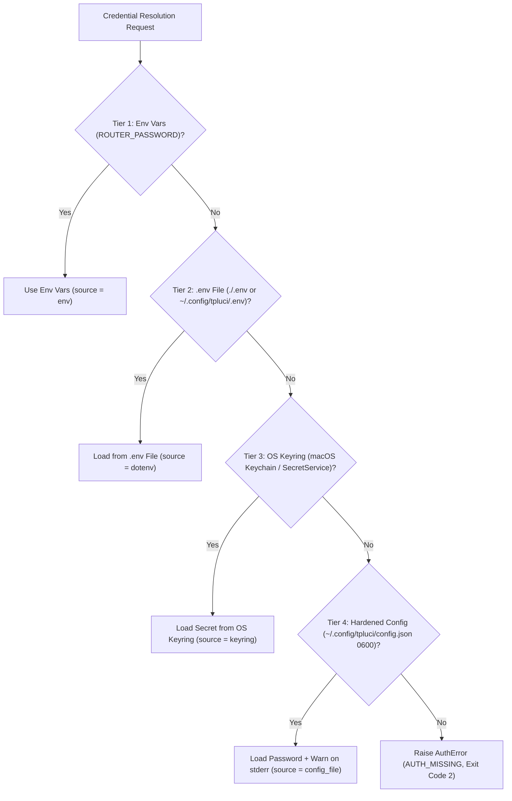
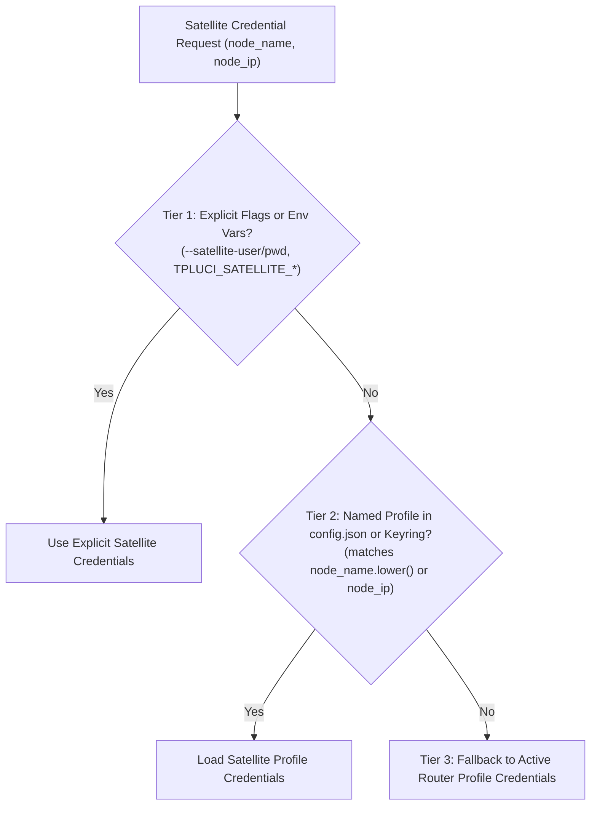

# `tpluci` System & Network Administrator Guide

This guide covers credential security, multi-router profile management, LuCI session concurrency, unattended automation guards, and troubleshooting for system and network administrators.

---

## 1. 4-Tier Credential Architecture & Security

`tpluci` resolves router credentials using a strict 4-tier hierarchy implemented in [`src/tpluci/config.py`](../src/tpluci/config.py). Higher-priority tiers override lower tiers, allowing seamless transitions between CI/CD pipelines, developer `.env` workspaces, desktop OS keychains, and headless Linux servers.



### Tier 1: Environment Variables (Highest Priority)

Ideal for containers, systemd units, Home Assistant shell integrations, and one-off overrides:

| Variable | Fallback Alias | Default | Purpose |
| :--- | :--- | :--- | :--- |
| `ROUTER_PASSWORD` | `TPLUCI_PASSWORD` | *(required)* | Router administrator password. |
| `ROUTER_URL` | `TPLUCI_URL` | `http://192.168.7.250` | Base HTTP URL of the router. |
| `ROUTER_USERNAME` | `TPLUCI_USERNAME` | `""` (empty / `admin`) | Router login username (Archer AX23 uses only password; hashed as `MD5("admin" + password)`). |
| `ROUTER_TIMEOUT` | `TPLUCI_TIMEOUT` | `5.0` | HTTP request timeout in seconds. |
| `TPLUCI_PROFILE` | `ROUTER_PROFILE` | `default` | Active configuration profile name. |
| `TPLUCI_CONFIG_DIR` | — | `~/.config/tpluci` | Override directory for `config.json` and global `.env`. |

### Tier 2: `.env` Files (`./.env` and `~/.config/tpluci/.env`)

If `ROUTER_PASSWORD` is not set in the process environment, `tpluci` checks:
1. `./.env` in the current working directory.
2. `~/.config/tpluci/.env` in the user's configuration directory.

Example `.env`:
```dotenv
ROUTER_URL=http://192.168.7.250
ROUTER_PASSWORD=YourRouterPassword
ROUTER_TIMEOUT=5.0
```

### Tier 3: OS Secure Keyring (Recommended for Workstations)

When you save a profile with `tpluci config` or `tpluci config add` (without `--no-keyring`), connection metadata (`url`, `username`, `timeout`, `use_keyring: true`) is written to `~/.config/tpluci/config.json`, while the password itself is stored in your operating system's native credential vault via Python `keyring`:
- **macOS**: macOS Keychain (`service="tpluci"`, `username="<profile>"`).
- **Linux**: Freedesktop SecretService / DBus (GNOME Keyring or KDE Wallet).
- **Windows**: Windows Credential Locker.

### Tier 4: Hardened `0600` Config File Fallback (Headless Servers)

On headless Linux servers (e.g., Raspberry Pi, Proxmox LXC, or SSH sessions without an active DBus SecretService daemon), pass `--no-keyring` when creating a profile:

```bash
tpluci config add --name default --url http://192.168.7.250 --password "YourRouterPassword" --no-keyring
```

- **Atomic `0600` File Creation**: `save_config()` creates `~/.config/tpluci/config.json` using low-level `os.open(path, os.O_WRONLY | os.O_CREAT | os.O_TRUNC | os.O_NOFOLLOW, 0o600)`. The file is born with `0600` (`-rw-------`) permissions and refuses symlink traversal (`O_NOFOLLOW`), preventing Time-of-Check to Time-of-Use (TOCTOU) exposure on multi-user systems.
- **Explicit Audit Warning**: Whenever Tier 4 is used in human output mode, `tpluci` emits a reminder to `stderr` (`stdout` remains untouched):
  ```text
  Warning: Using plaintext password storage in /home/admin/.config/tpluci/config.json. OS keyring not available or disabled.
  ```

---

## 2. Multi-Router Profile Management

Administrators managing multiple TP-Link routers (e.g., `main-router`, `office-ap`, `lab-ax23`) can configure named profiles and switch between them seamlessly.

### Interactive Wizard (`tpluci config`)

When invoked in an interactive terminal (`sys.stdin.isatty()`) without arguments, `tpluci config` opens an `rclone`-style menu:

```text
$ tpluci config

--- tpluci Configuration ---
  n) Add / New profile
  e) Edit existing profile
  l) List profiles
  d) Delete profile
  s) Set default profile
  t) Test connection
  q) Quit
Choose an option [q]:
```

> **Non-Interactive Safety:** If `tpluci config` is called without subcommands inside a non-interactive pipe or script (`not sys.stdin.isatty()`), it automatically runs `tpluci config list` and exits `0` instead of hanging on `stdin`.

### Headless Profile Provisioning

```bash
# 1. Add profiles for two routers
tpluci config add --name home --url http://192.168.7.250 --password "HomeSecretPassword"
tpluci config add --name lab --url http://192.168.8.1 --password "LabSecretPassword" --timeout 10.0

# 2. Set the default profile
tpluci config default --name home

# 3. List configured profiles (passwords are always masked)
$ tpluci config list
DEFAULT  PROFILE  URL                   KEYRING  TIMEOUT
-------  -------  --------------------  -------  -------
*        home     http://192.168.7.250  yes      5.0s   
         lab      http://192.168.8.1    yes      10.0s  

# 4. Verify connectivity and RSA+AES authentication for a specific profile
$ tpluci config test --profile lab
Success: Connected and authenticated with router at http://192.168.8.1.

# 5. Query any command against a specific profile
tpluci --profile lab status
TPLUCI_PROFILE=lab tpluci wifi list

# 6. Delete a profile (removes both config.json entry and OS Keyring secret)
tpluci config delete --name lab
```

### Satellite Extender Credential Resolution & TP-Link Cloud ID Binding

When using direct satellite management commands (`tpluci mesh reboot`, `tpluci mesh led`, `tpluci mesh reboot-schedule`), `tpluci` resolves satellite credentials through a 3-tier resolution cascade implemented in `resolve_satellite_credentials()`:



1. **Tier 1 (Explicit Invocations):** Pass `--satellite-user <USER>` and `--satellite-password <PWD>` on the CLI, or export `TPLUCI_SATELLITE_USER` and `TPLUCI_SATELLITE_PASSWORD` in your environment.
2. **Tier 2 (Named Satellite Profiles):** Create a named profile in `tpluci config` matching the satellite's name (case-insensitive, e.g. `re705x` or `satellite-office`) or its IP address (e.g. `192.168.7.2`):
   ```bash
   tpluci config add --name re705x --url https://192.168.7.2 --username admin@example.com --password "SatelliteCloudPass"
   ```
3. **Tier 3 (Router Credential Fallback):** If no satellite-specific credentials exist, `tpluci` transparently falls back to the active primary router's credentials.

#### Important Notes on TP-Link Cloud ID Binding (Tether App)

When mesh extenders (such as `RE705X` or `RE300`) are adopted or onboarded through the TP-Link Tether mobile application, the extender firmware binds to your **TP-Link Cloud ID (email)**:
- On **Architecture 2 (`RE705X`)**: The extender pre-flight check reports `cloud_ever_login: true`. Standard local password authentication is rejected, requiring authentication against `/cgi-bin/luci/;stok=/login?form=cloud_login` with your TP-Link Cloud ID email and password.
- On **Architecture 3 (`RE300`)**: The extender TDDP block `68` (`CLOUD_CURRENT_USER_CFG_DATA_ID`) reports `isBinded: 1`. Local XOR challenge authentication is rejected, requiring cloud authentication.

If login fails and cloud binding is detected, `tpluci` raises an `AuthError` containing an exact, copy-paste remediation command showing how to provide satellite credentials or save a dedicated profile.

---

## 3. Session Lifecycle & Router Concurrency

### Why Session Caching Matters on TP-Link Firmware

TP-Link's embedded OpenWrt/LuCI web server (`uhttpd`) enforces a **strict single-active-admin-session policy**:
1. Logging into the router Web UI in a browser invalidates any prior CLI/API `stok` token (and vice versa).
2. Performing a full 3-step RSA+AES login handshake on every single CLI call adds ~180ms of latency and rapidly exhausts router entropy/session slots if scripts run back-to-back.

### Ephemeral `0600` Session Cache

`tpluci` solves this with [`SessionCache`](../src/tpluci/session.py):
- **Location**: `$TMPDIR/tpluci-session-<uid>-<profile>.json` (e.g., `/tmp/tpluci-session-1000-default.json`).
- **Permissions**: Created atomically with `os.open(..., 0o600 | os.O_NOFOLLOW)` so only the owning OS user UID can read the cached session state.
- **Stored State**: `stok` (LuCI session token), ephemeral 16-digit `aes_key` and `aes_iv`, base `seq` counter, `nn_auth`/`ee_auth` RSA signing key, HTTP session `cookies`, `url`, `password_hash`, and `updated_at` timestamp.
- **TTL (Time-To-Live)**: `180.0` seconds (sliding window updated on every successful API call).
- **Target Binding**: Before reusing a cached session, `RouterClient.login()` verifies that both `cached.url == base_url` and `cached.password_hash == expected_pwd_hash`. Overriding `--url` on the CLI automatically bypasses a mismatched cache entry.

### Transparent Auto-Recovery on `401` / `403` / Session Expiry

If you log into the router's Web UI from a browser while a CLI session is cached, the router invalidates the cached `stok`. On the very next `tpluci` command:
1. `RouterClient.call()` detects HTTP `401`/`403` or LuCI `"errorcode": "session timeout"` / `"-1"`.
2. Clears the stale `/tmp` cache file.
3. Transparently executes a fresh RSA+AES login handshake once.
4. Replays the failed API request and saves the new session.

### Rate-Limiting Safeguards (`50ms` Spacing)

Embedded router CPUs can drop TCP connections if flooded with rapid HTTP POST requests. `RouterClient` enforces a minimum `50ms` (`rate_limit_delay=0.05`) interval between consecutive HTTP requests within the same process, including multi-request commands like `tpluci wan`, `tpluci lan`, and `tpluci wifi set`.

### Bypassing or Clearing the Cache

```bash
# Force a fresh RSA+AES login handshake for a single command
tpluci --no-cache status

# Explicitly clear the local session cache for a profile
$ tpluci logout
Local session cache cleared for profile 'default'.
```

---

## 4. Safety Guards & Unattended Automation

### Non-Interactive TTY Guards

Destructive operations (`tpluci system reboot`, `tpluci mesh reboot`, `tpluci mesh remove`, `tpluci mesh firmware --upgrade`, and `tpluci clients block`) check `sys.stdin.isatty()`:
- In an **interactive terminal**, `tpluci` prompts the operator for explicit confirmation unless `--confirm` is passed.
- In a **non-interactive environment** (cron jobs, systemd services, Home Assistant `shell_command`, or AI agent subprocesses), omitting `--confirm` never hangs waiting for input—it immediately exits with code `5` (`SAFETY_ABORT`).

```bash
$ tpluci system reboot --json < /dev/null
{
  "ok": false,
  "error_code": "SAFETY_ABORT",
  "message": "Refusing to reboot router in non-interactive environment without --confirm.",
  "hint": "Pass --confirm to authorize router reboot: tpluci system reboot --confirm"
}
```

### Host Device Self-Lockout Protection (`HOST` Guard)

Accidentally blocking the management workstation or server that runs `tpluci` would sever network connectivity and lock the operator out of the router.

To eliminate this operational hazard:
1. `tpluci clients block <TARGET>` queries `access_control?form=black_devices` (`operation="load"`) and `access_control?form=enable`.
2. The router's LuCI backend explicitly tags the current calling device with `host: "HOST"` and exposes `host_mac`.
3. If `<TARGET>` matches the IP, MAC, or hostname of this managing host device, `tpluci` **refuses execution** and immediately raises `SafetyAbortError` (exit code `5`), even if `--confirm` was passed:

```bash
$ tpluci clients block 192.168.7.101 --confirm --json
{
  "ok": false,
  "error_code": "SAFETY_ABORT",
  "message": "Refusing to block the current host device (HOST) to prevent router lockout.",
  "hint": "Specify a different client IP, MAC, or hostname to block."
}
```

### Standard Exit Codes

| Exit Code | Constant | Exception Class | Meaning |
| :---: | :--- | :--- | :--- |
| **`0`** | `EXIT_OK` | — | Command succeeded. |
| **`1`** | `EXIT_USAGE_ERROR` | `TpluciError` / `ClickException` | Invalid CLI flags, missing arguments, invalid `--password` length, or requested `--field` not found. |
| **`2`** | `EXIT_AUTH_ERROR` | `AuthError` | Missing credentials (`AUTH_MISSING`), wrong password (`AUTH_FAILED`), or rejected session (`AUTH_EXPIRED`). |
| **`3`** | `EXIT_NETWORK_ERROR` | `NetworkError` | Router unreachable (`NETWORK_UNREACHABLE`), connection timed out (`NETWORK_TIMEOUT`), or transport failure. |
| **`4`** | `EXIT_LUCI_ERROR` | `LuciApiError` | Router LuCI backend returned an error or unsupported form (`LUCI_NO_CALLBACK`, `LUCI_ERROR`). |
| **`5`** | `EXIT_SAFETY_ABORT` | `SafetyAbortError` | Destructive operation blocked by safety guard (`SAFETY_ABORT`). |

### Automation Examples

#### Cron Job: Nightly Guest Wi-Fi Shutoff

```cron
# Disable both 2.4 GHz and 5 GHz Guest Wi-Fi every night at 23:30
30 23 * * * /usr/local/bin/tpluci --profile default wifi set guest-2g --disable --json >> /var/log/tpluci.log 2>&1
31 23 * * * /usr/local/bin/tpluci --profile default wifi set guest-5g --disable --json >> /var/log/tpluci.log 2>&1
```

#### Home Assistant `configuration.yaml` Integration

```yaml
shell_command:
  guest_wifi_2g_on: "tpluci wifi set guest-2g --enable --json"
  guest_wifi_2g_off: "tpluci wifi set guest-2g --disable --json"

command_line:
  - sensor:
      name: "Archer AX23 Status"
      command: "tpluci status --json"
      scan_interval: 60
      value_template: "{{ value_json.internet_status }}"
      json_attributes:
        - cpu_usage
        - mem_usage
        - wan_ip
        - uptime_seconds
        - clients_count
```

---

## 5. Troubleshooting Runbook

| Error Code | Exit Code | Cause | Exact Remediation Steps |
| :--- | :---: | :--- | :--- |
| **`AUTH_MISSING`** | `2` | No password found across Env Vars, `.env`, OS Keyring, or `config.json` for the target profile. | 1. Run `tpluci config add --name default --url http://192.168.7.250`<br/>2. Or export `ROUTER_PASSWORD="your_password"` in your environment or `.env` file. |
| **`AUTH_FAILED`** | `2` | Router rejected login handshake (`login failed` or remaining login attempts decremented). | 1. Verify the web admin password by logging into `http://192.168.7.250` in a browser.<br/>2. Update stored credentials with `tpluci config add --name default --url http://192.168.7.250`<br/>3. Clear any stale session cache with `tpluci logout`. |
| **`AUTH_DECRYPT_ERROR`** | `2` | Failed to decrypt AES response during login. | Another device may have collided with the login sequence mid-handshake. Run `tpluci --no-cache status`. |
| **`NETWORK_TIMEOUT`** | `3` | HTTP request exceeded timeout (default `5.0s`). | 1. Verify you are connected to the router's LAN/Wi-Fi.<br/>2. Increase the timeout: `tpluci --timeout 15.0 status`. |
| **`NETWORK_UNREACHABLE`** | `3` | TCP connection refused or host unreachable. | 1. Check the router's LAN IP (`ip route` or `netstat -rn`).<br/>2. Pass `--url http://192.168.0.1` (or your router's IP) and update the profile with `tpluci config add`. |
| **`LUCI_NO_CALLBACK`** | `4` | Router returned `"errorcode": "no such callback"` for the requested `<module>?form=<form>`. | The firmware does not compile that form handler (e.g., `wireless?form=guest_network` is split into `guest_2g` and `guest_5g` on Archer AX23). Run `tpluci call --list` to inspect all 30 verified endpoints. |
| **`LUCI_FIELD_NOT_FOUND`** | `1` | Key requested via `tpluci status --field <KEY>` does not exist in `status?form=all`. | Run `tpluci status --full --json` to inspect all 199 available telemetry keys on your firmware version. |
| **`SAFETY_ABORT`** | `5` | `tpluci system reboot` or MCP `router_reboot` invoked without explicit confirmation. | Pass `--confirm` on the CLI (`tpluci system reboot --confirm`) or `confirm=True` in the MCP tool call. |
