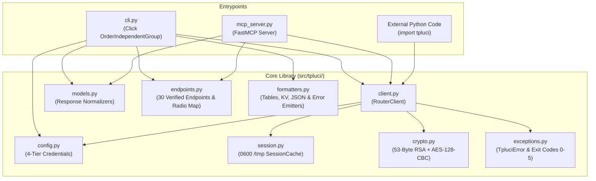

# `tpluci` Developer & Contributor Guide

This guide documents the internal architecture of `tpluci`, TP-Link's encrypted LuCI CGI cryptographic protocol, Python library usage, endpoint extension patterns, and our test and open-source sanitization workflow.

---

## 1. Architecture & Module Map

`tpluci` is structured as a standard `src/` layout Python package (`src/tpluci/`) with strict separation between transport/cryptography, data normalization, CLI presentation, and the FastMCP server.



### Module Breakdown (`src/tpluci/`)

| Module | Responsibility |
| :--- | :--- |
| [`cli.py`](../src/tpluci/cli.py) | Pure `click` CLI entrypoint (`tpluci`). Implements `OrderIndependentGroup` so global flags (`--json`, `--plain`, `--profile`, `--url`, `--timeout`, `--no-cache`) are parsed at any position without stripping subcommand options. |
| [`client.py`](../src/tpluci/client.py) | `RouterClient`: manages `httpx.Client`, 50ms rate limiting, 3-step RSA+AES login handshake, transparent session auto-recovery, `call()`, and safe `read_modify_write()`. |
| [`crypto.py`](../src/tpluci/crypto.py) | Pure-Python cryptographic primitives matching TP-Link's `tpEncrypt.js` and `encrypt.js`: `md5_hash()`, `generate_aes_key_iv()`, `aes_encrypt()`, `aes_decrypt()`, `rsa_encrypt_chunk()`, `rsa_encrypt()`, and `build_signature()`. |
| [`config.py`](../src/tpluci/config.py) | 4-tier credential resolver (`env` $\to$ `.env` $\to$ `keyring` $\to$ `0600 ~/.config/tpluci/config.json`) and profile CRUD helpers. |
| [`session.py`](../src/tpluci/session.py) | `SessionData` and `SessionCache`: atomic `0600` (`O_NOFOLLOW`) read/write of session tokens and encryption keys in `$TMPDIR/tpluci-session-<uid>-<profile>.json` with a 180-second TTL. |
| [`models.py`](../src/tpluci/models.py) | Data normalizers (`parse_status_summary`, `parse_clients`, `parse_wifi_summary`, `parse_wan_info`, `parse_lan_info`), including `[0.0, 1.0]` float-to-percentage conversion and natural IPv4 sorting. |
| [`endpoints.py`](../src/tpluci/endpoints.py) | `WIFI_RADIO_MAP` (mapping `2g`, `5g`, `guest-2g`, `guest-5g`, `iot-2g`, `iot-5g` to LuCI forms) and `VERIFIED_ENDPOINTS` (catalog of 30 verified Archer AX23 endpoints). |
| [`formatters.py`](../src/tpluci/formatters.py) | Zero-dependency space-padded table formatter (`format_table`), aligned key-value formatter (`format_key_value`), and `stdout`/`stderr` stream emitters (`emit_output`, `emit_error`). |
| [`exceptions.py`](../src/tpluci/exceptions.py) | Structured exception hierarchy (`TpluciError`, `AuthError`, `NetworkError`, `LuciApiError`, `SafetyAbortError`) with `.to_dict()` JSON error envelopes and semantic exit codes (`0`–`5`). |
| [`mcp_server.py`](../src/tpluci/mcp_server.py) | `tpluci-mcp` binary entrypoint exposing 7 tools via `mcp.server.fastmcp.FastMCP`. |

### Maintaining the <50ms Startup Budget

To keep `tpluci --help` and cached CLI invocations under 50ms:
1. **No `rich` or `typer`**: Formatting in `formatters.py` uses pure Python string alignment (`ljust`), avoiding `rich`'s ~80ms import cost.
2. **Lazy Imports on Heavy Paths**:
   - `RouterClient` (`httpx` + `cryptography`) is imported inside `get_client()` only when a command actually needs network communication (`tpluci --help`, `tpluci call --list`, and `tpluci config list` never import `httpx`).
   - `keyring` and `dotenv` are imported lazily inside `config.py` only when Tier 2 or Tier 3 credential resolution is reached.
   - `mcp` (`FastMCP`) is isolated inside `mcp_server.py` and never imported by `cli.py`.

---

## 2. Cryptographic Protocol Deep-Dive

TP-Link's customized OpenWrt/LuCI firmware replaces standard `ubus` JSON-RPC with an encrypted CGI dispatcher at `/cgi-bin/luci/;stok=<TOKEN>/admin/<MODULE>?form=<FORM>`. All payloads are form-urlencoded `sign=<RSA_HEX>&data=<AES_BASE64>`.

### Handshake & Request Sequence Diagram

```mermaid
sequenceDiagram
    autonumber
    participant Client as tpluci (RouterClient)
    participant Router as TP-Link LuCI (/cgi-bin/luci)

    Note over Client,Router: Phase 1: Login Handshake (Skipped when /tmp cache is valid)
    Client->>Router: POST /cgi-bin/luci/;stok=/login?form=keys (operation=read)
    Router-->>Client: {"data": {"password": ["<nn_keys_hex>", "<ee_keys_hex>"]}} (512-bit RSA)

    Client->>Router: POST /cgi-bin/luci/;stok=/login?form=auth (operation=read)
    Router-->>Client: {"data": {"key": ["<nn_auth_hex>", "<ee_auth_hex>"], "seq": 599694923}}

    Note over Client: 1. Encrypt password with (nn_keys, ee_keys)<br/>2. Generate 16-digit ASCII AES key & IV<br/>3. h = MD5("admin" + password)<br/>4. data = AES_CBC("operation=login&password=" + urlencode(enc_pwd))<br/>5. s = seq + len(data)<br/>6. sign = RSA_auth("k=<key>&i=<iv>&h=<h>&s=<s>")

    Client->>Router: POST /cgi-bin/luci/;stok=/login?form=login (sign=..., data=...)
    Router-->>Client: Set-Cookie: sysauth=... + {"data": "<AES_B64_CIPHERTEXT>"}
    Note over Client: Decrypt data -> {"success": true, "data": {"stok": "a1b2c3..."}}<br/>Save {stok, key, iv, seq, nn_auth, ee_auth, cookies} to 0600 /tmp cache

    Note over Client,Router: Phase 2: Authenticated API Call (~30ms)
    Note over Client: 1. data = AES_CBC("operation=read")<br/>2. s = seq + len(data)<br/>3. sign = RSA_auth("h=<h>&s=<s>")
    Client->>Router: POST /cgi-bin/luci/;stok=<stok>/admin/status?form=all (sign=..., data=...)
    Router-->>Client: {"data": "<AES_B64_CIPHERTEXT>"}
    Note over Client: Decrypt AES_B64_CIPHERTEXT -> {"success": true, "data": { ...199 keys... }}
```

### Critical Cryptographic Implementation Details (`crypto.py`)

1. **Two Distinct RSA Public Keys**:
   - `/login?form=keys` returns `data.password = [nn_keys, ee_keys]` (typically a **512-bit / 64-byte** RSA key on Archer AX23) used strictly to encrypt the raw admin password during login.
   - `/login?form=auth` returns `data.key = [nn_auth, ee_auth]` (typically a **1024-bit / 128-byte** RSA key) and `data.seq` (base integer sequence number) used to encrypt the `sign` parameter on login and all subsequent requests.
2. **Why Pure-Python RFC 2313 PKCS#1 v1.5 + `pow()` Is Used**:
   - Modern OpenSSL 3.x (and `cryptography`'s C backend) rejects 512-bit RSA keys with `ValueError: key_size must be at least 1024-bits`.
   - `rsa_encrypt_chunk()` constructs the RFC 2313 PKCS#1 v1.5 encryption block `0x00 || 0x02 || PS (non-zero random bytes) || 0x00 || chunk_bytes` and computes `pow(int.from_bytes(em, "big"), ee, nn)` in pure Python, supporting both 512-bit and 1024/2048-bit keys with zero C-extension restrictions.
3. **53-Byte UTF-8 Chunking**:
   - A 512-bit (64-byte) RSA key with 11 bytes of PKCS#1 v1.5 overhead (`0x00 0x02` + at least 8 bytes of `PS` + `0x00`) can encrypt at most $64 - 11 = 53\text{ bytes}$ per block.
   - `rsa_encrypt()` encodes the plaintext to UTF-8 bytes first and slices into 53-byte chunks (`data_bytes[i : i + 53]`), formatting each encrypted chunk as zero-padded lowercase hex matching `len(nn_hex)` and concatenating them.
4. **Ephemeral 16-Digit ASCII AES-128-CBC Key & IV**:
   - `generate_aes_key_iv()` generates two 16-character random numeric strings (e.g., `"4819203817263541"`), which serve as 16-byte UTF-8 keys for AES-128-CBC with PKCS7 (128-bit block) padding and Base64 output.
5. **Sequence Number Calculation (`s = seq + len(data_enc)`)**:
   - Rather than incrementing `seq` by `1`, TP-Link's `tpEncrypt.js` computes the signature sequence number as the base `seq` (from `/login?form=auth`) plus the character length of the Base64-encoded AES `data` payload: `seq_with_data_len = session.seq + len(data_enc)`.

---

## 3. Using `tpluci` as a Python Library

You can import `RouterClient` directly in Python scripts, FastAPI services, or custom automation tools.

### Basic Read & Context Manager Usage

```python
from tpluci.client import RouterClient
from tpluci.config import resolve_credentials
from tpluci.models import parse_status_summary, parse_clients

# Automatically resolves credentials across Tier 1 (env) -> Tier 2 (.env) -> Tier 3 (Keyring) -> Tier 4 (config.json)
creds = resolve_credentials(profile="default")

with RouterClient(creds=creds, use_cache=True) as client:
    # 1. Fetch raw 199-key master dictionary
    raw_all = client.call("status", "all")

    # 2. Normalize into curated dashboard summary
    summary = parse_status_summary(raw_all)
    print(f"WAN IP: {summary['wan_ip']} | CPU: {summary['cpu_usage']}%")

    # 3. Search connected 5 GHz wireless clients
    clients_5g = parse_clients(raw_all, medium="wireless", band="5g", sort_by="ip")
    for c in clients_5g:
        print(f"  {c['ipaddr']:15} {c['macaddr']}  {c['hostname']}")
```

### Safe Mutations with `read_modify_write()`

When modifying a LuCI form via `operation=write`, TP-Link firmware expects all existing scalar configuration keys for that form to be echoed back in the POST payload. However, several forms (such as `wireless?form=wireless_2g`) include nested read-only metadata dictionaries or lists (like `"extinfo": {"support_band": "both", ...}`) in their `operation=read` response that cause LuCI errors if echoed back on `operation=write`.

`RouterClient.read_modify_write()` handles this automatically:
1. Calls `self.call(module, form, operation="read")`.
2. Merges your `updates` dictionary and computes a `before`/`after` `diff`.
3. Filters out any nested `dict` or `list` values (`{k: v for k, v in merged.items() if not isinstance(v, (dict, list))}`).
4. Sends `operation="write"` only if `changed is True` and `dry_run is False`.

```python
from tpluci.client import RouterClient

with RouterClient() as client:
    # Simulate enabling Guest 2.4 GHz network
    receipt = client.read_modify_write(
        module="wireless",
        form="guest_2g",
        updates={"enable": "on", "ssid": "GuestNet_2G"},
        dry_run=True,
    )
    print("Changed:", receipt["changed"])
    print("Diff:", receipt["diff"])
```

---

## 4. Extending Endpoints & Normalizers

### Step 1: Discover and Verify an Endpoint with `tpluci call`

Use `tpluci call` to probe candidate `<module>` and `<form>` names on your router:

```bash
# Test reading the QoS settings endpoint
tpluci call qos settings --json
```

If the router returns `"errorcode": "no such callback"` (`LUCI_NO_CALLBACK`), that form is not compiled into your router's firmware build.

### Step 2: Register the Endpoint in `src/tpluci/endpoints.py`

Add newly verified endpoints to [`VERIFIED_ENDPOINTS`](../src/tpluci/endpoints.py) so they appear in `tpluci call --list`:

```python
# src/tpluci/endpoints.py
VERIFIED_ENDPOINTS: list[dict[str, str]] = [
    # ...
    {
        "module": "qos",
        "form": "settings",
        "category": "Security",
        "description": "Quality of Service bandwidth limits and prioritization",
    },
]
```

### Step 3: Add a Normalizer in `src/tpluci/models.py`

When adding a first-class CLI command or MCP tool, write a pure normalization function in [`src/tpluci/models.py`](../src/tpluci/models.py) that accepts the raw dictionary from `client.call()` and returns a clean, predictable schema with safe defaults.

> **Hardware Quirks to Watch For:**
> - **Boolean Strings**: TP-Link forms represent booleans inconsistently across endpoints (`"on"`/`"off"`, `"On"`/`"Off"`, or `true`/`false`). Normalize with `str(val).lower() == "on"`.
> - **CPU/RAM Ratios**: On physical Archer AX23 firmware, `cpu1_usage` and `mem_usage` in `status?form=all` are returned as floats in `[0.0, 1.0]` (e.g. `0.11` for `11%`), whereas some firmware revisions return integers `0`–`100`. Use `_normalize_percentage()` in `models.py`.
> - **Split WAN Telemetry**: `network?form=wan_ipv4_status` only returns `{"autodetect": "off", "conntype": "pppoe"}` on Archer AX23; the actual WAN IP, DNS servers (`wan_ipv4_pridns`, `wan_ipv4_snddns`), gateway, and WAN MAC (`wan_macaddr`) live inside `status?form=all`. `parse_wan_info(raw_wan, raw_all)` merges both sources.

---

## 5. Testing & Open-Source Release Workflow

`tpluci` maintains 77 automated tests split into fast offline unit tests (`tests/unit/`) and live hardware integration tests (`tests/integration/`).

### Running Offline Unit Tests (`tests/unit/`)

Offline unit tests use `respx` to mock the router's HTTP endpoints with real RSA/AES encryption round-trips and sanitized fixtures ([`tests/fixtures/sanitized_status_all.json`](../tests/fixtures/sanitized_status_all.json)). They run in ~0.4 seconds without network access:

```bash
uv run pytest tests/unit -v
```

| Unit Test Suite | Coverage Area |
| :--- | :--- |
| [`tests/unit/test_crypto.py`](../tests/unit/test_crypto.py) | MD5 hashing, 16-digit AES key/IV generation, AES-128-CBC round-trips, 512-bit & 1024-bit RSA 53-byte UTF-8 chunking, and login/request signature formatting. |
| [`tests/unit/test_config.py`](../tests/unit/test_config.py) | All 4 credential tiers, `TPLUCI_PROFILE` resolution, atomic `0600` file permissions, and profile CRUD operations. |
| [`tests/unit/test_session_and_client.py`](../tests/unit/test_session_and_client.py) | Ephemeral `0600` session cache TTL/URL/password-hash binding, 3-step login handshake, encrypted `call()`, automatic re-login on HTTP `403`/timeout, and `read_modify_write()` nested-object stripping. |
| [`tests/unit/test_models.py`](../tests/unit/test_models.py) | Status dashboard normalization (including float CPU/RAM ratios), client filtering/natural IP sorting, Wi-Fi 6-radio summary, and combined WAN/LAN parsers. |
| [`tests/unit/test_exceptions.py`](../tests/unit/test_exceptions.py) | `TpluciError`, `AuthError`, `NetworkError`, `LuciApiError`, and `SafetyAbortError` envelopes and exit codes (`0`–`5`). |
| [`tests/unit/test_cli_base.py`](../tests/unit/test_cli_base.py) | Position-agnostic global flags (`OrderIndependentGroup`), `config` subcommands, and `logout`. |
| [`tests/unit/test_cli_readonly.py`](../tests/unit/test_cli_readonly.py) | Read-only CLI commands (`status`, `clients`, `wifi list`, `wifi get`, `wan`, `lan`, `system info/time`, `call --list`). |
| [`tests/unit/test_cli_mutations.py`](../tests/unit/test_cli_mutations.py) | Mutating CLI commands (`wifi set` with `--dry-run`, `system reboot` TTY safety guards, and `call` write operations). |
| [`tests/unit/test_mcp_server.py`](../tests/unit/test_mcp_server.py) | All 7 FastMCP tools (`router_get_status`, `router_list_clients`, `router_get_wifi`, `router_set_wifi`, `router_get_network_info`, `router_reboot`, `router_raw_call`) and `TpluciError` JSON envelopes. |

### Running Live Router Integration Tests (`tests/integration/`)

When a `.env` file is present in the repository root and the physical router is reachable, `tests/integration/test_live_router.py` runs 5 non-destructive live verification tests (`status`, `wifi list`, `clients`, `wifi set guest-2g --enable --dry-run`, and `wan`):

```bash
# Run only live router integration tests
uv run pytest tests/integration -v

# Run the entire 77-test suite (unit + live integration)
uv run pytest -v
```

*(If `.env` is absent, the integration tests are automatically skipped via `@pytest.mark.skipif`.)*

---

## 6. Pre-Release Sanitization Audit Checklist

Before exporting commits or opening a pull request to the public open-source repository, verify that **zero personal network telemetry** exists in tracked files:

1. **Quarantined Directories Never Exported**:
   - Never copy or commit `.env` or `research/private_dumps/` into the public repository.
2. **Synthetic / RFC 5737 Addresses Only**:
   - All documentation, unit tests, and fixtures (`tests/fixtures/sanitized_status_all.json`) must exclusively use RFC 5737 documentation IPs (`203.0.113.x`), local subnet IPs (`192.168.7.x`), synthetic MACs (`AA-BB-CC-11-22-33`, `AA-BB-CC-DD-EE-01`), and synthetic SSIDs (`HomeNet_2G`, `HomeNet_5G`, `GuestNet_2G`, `TestNet_2G`, etc.).
3. **Automated Grep Audit**:
   Run a case-insensitive search across `src/`, `tests/`, `docs/`, and `README.md` to confirm zero matches for real router SSIDs, real external WAN IPs, hardware MACs, or Wi-Fi passphrases before tagging a release.
