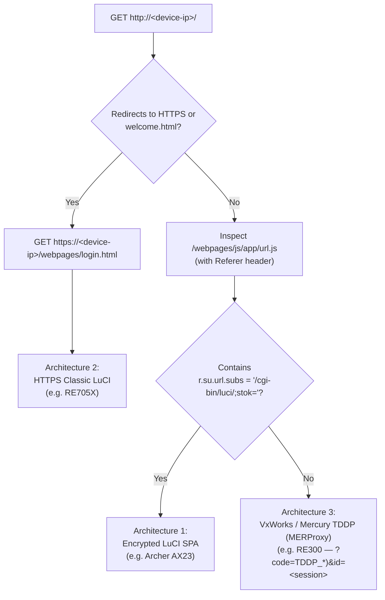

# TP-Link Firmware Endpoint Discovery & Reverse-Engineering Guide

This guide documents the exact methodology used to discover hidden API endpoints, custom operation verbs, and payload schemas across TP-Link Archer routers and EasyMesh/OneMesh range extenders—**without** blind brute-forcing, firmware unpacking, or running a headless browser.

If you are adapting `tpluci` to a different TP-Link router, adding support for a new hardware feature, or integrating mesh extenders on your own network, following this workflow will save you hours of trial and error.

---

## 1. Why Blind Endpoint Probing Fails

During initial exploration, probing common `<module>?form=<form>` combinations with a default `operation=read` payload (`test_luci_api_suite.py`) found 30 working endpoints—but falsely reported 58 candidates as `"unsupported"` (`"errorcode": "no such callback"` or HTTP `400`/`401`/`404`).

Static inspection of the router's frontend JavaScript revealed **four reasons** why blind probing misses active endpoints:

1. **Custom `operation` Verbs (Not `operation=read`):**
   Many LuCI controllers reject `operation=read` and only respond to specific verbs:
   * `smart_network?form=game_accelerator` requires `operation=loadDevice` or `operation=loadSpeed` (returns real-time per-client upload/download speeds, cumulative traffic bytes, signal dBm, and TX/RX link rates).
   * `firmware?form=slave_cmd` requires `operation=slave_get_info` or `operation=slave_upgrade_firmware` (returns EasyMesh satellite firmware versions and triggers OTA upgrades).
   * `access_control?form=black_devices` requires `operation=load` or `operation=block`.
   * `status?form=client_status` requires `operation=load`.
2. **Non-Obvious Module & Form Naming:**
   * Router LED controls are not under `led_ctrl?form=settings`; they are split across `ledgeneral?form=setting` (master toggle) and `ledpm?form=setting` (Night Mode schedule).
   * Scheduled reboot is not under `system?form=reboot`; it lives at `reboot?form=set` while immediate reboot is `system?form=reboot` with `operation=reboot`.
   * Client renaming is dispatched through `traffic?form=dev_name` (`operation=write&mac=<MAC>&alias=<NAME>`).
3. **Dynamic `%prefix%` Substitution (`easymesh` vs. `onemesh`):**
   * The Web UI dynamically rewrites `/admin/%prefix%_network?form=...` to either `easymesh_network` or `onemesh_network` based on `device.getConfig().supportOneMesh`.
4. **Embedded Web Server Header & Transport Guards:**
   * Range extenders like the **RE705X** enforce HTTPS (`https://`) under EU CE RED regulations and return `400 Bad Request` on HTTP or when the `Referer` header is omitted.
   * Range extenders like the **RE300** return `401 Unauthorized` (empty body) even for public static JS files unless `Referer: http://<device-ip>/` is passed.

---

## 2. The Three TP-Link Web Firmware Architectures

A single TP-Link EasyMesh network often mixes devices from different hardware generations. Before probing endpoints, **fingerprint which of the three web stacks your target device runs**:



| Characteristic | Architecture 1: Encrypted LuCI SPA | Architecture 2: HTTPS Classic LuCI | Architecture 3: TDDP / `MERProxy` (+ GDPR) |
| :--- | :--- | :--- | :--- |
| **Representative Hardware** | Archer AX23, AX21, AX55, AX73 | RE705X, newer EU CE RED repeaters | RE300, RE450, AC/Wi-Fi 5 repeaters |
| **Transport** | `http://<ip>` | `https://<ip>` (self-signed cert) | `http://<ip>` |
| **`Referer` Header Required?** | No | **Yes** (`https://<ip>/webpages/...`) | **Yes** (`http://<ip>/`) |
| **Endpoint URL Pattern** | `/cgi-bin/luci/;stok=<STOK>/admin/<mod>?form=<form>` | `/cgi-bin/luci/;stok=<STOK>/admin/<mod>?form=<form>` | `/?code=<OPCODE>&asyn=0&id=<SESSION>` |
| **Key Exchange Endpoint** | `POST /cgi-bin/luci/;stok=/login?form=keys` & `form=auth` | `POST /cgi-bin/luci/;stok=/login?form=login` (`operation=read`) | `POST /?code=16&asyn=0` (`get`) + `POST /?code=7&asyn=1` |
| **RSA Padding Mode** | Raw big-endian (`nopadding`, 53-byte chunks) | **PKCS#1 v1.5 random type-2** (`pkcs1pad2`) | **PKCS#1 v1.5 random type-2** (53-byte chunks) |
| **Payload Encryption** | AES-128-CBC (`data`) + RSA (`sign`, MD5 hash) | RSA password on login; **plaintext form body** over TLS | XOR dict (`$.su.encrypt`) auth + GDPR AES-128-CBC (`data`) & RSA (`sign`, SHA-256 hash) |
| **Route Manifest Location** | `/webpages/config/models.json` & `modules.json` | `/webpages/index.html` & `/webpages/pages/userrpm/*.html` | `/config/models.json` & `/js/su/frame.js` |

---

## 3. Step-by-Step Discovery Workflow (Architecture 1: Encrypted LuCI SPA)

All frontend JavaScript files on TP-Link LuCI routers are served **unauthenticated** under `/webpages/`. You do not need to log in or launch a browser to read the complete API specification of your router.

### Step 1: Fetch the Entry HTML and URL Helper

```bash
curl -s http://192.168.0.1/webpages/index.html
curl -s http://192.168.0.1/webpages/js/app/url.js
```

Confirm that `url.js` defines `r.su.url.subs = "/cgi-bin/luci/;stok="`.

### Step 2: Download the Master Model & Module Manifests

Modern TP-Link LuCI firmware uses a lazy-loaded MVC framework (`$.su.ModelManager`, `$.su.StoreManager`, `$.su.ModuleManager`) defined in `/webpages/js/su/frame.js`.

Two static JSON files map **every data model and UI module** to its JavaScript source file:
* `http://192.168.0.1/webpages/config/models.json`
* `http://192.168.0.1/webpages/config/modules.json`

Use a quick Python one-liner to list all model/controller script paths on your router:

```bash
uv run python -c '
import httpx
models = httpx.get("http://192.168.0.1/webpages/config/models.json").json()
for path in sorted(set(models.values())):
    print(path.split("?")[0])
'
```

On the Archer AX23 V1, this immediately reveals ~90 modular JS files organized by feature:
* `./modules/advanced/oneMesh/models.js`
* `./modules/advanced/oneMesh/easyMesh/controllers.js`
* `./modules/networkMap/mapClients/models.js`
* `./modules/networkMap/mapClients/controllers.js`
* `./modules/advanced/system/firmware/script.js`
* `./modules/advanced/system/reboot/models.js`
* `./modules/advanced/system/led/models.js`

### Step 3: Extract Endpoints, `operation` Verbs, and Field Mappings

Fetch the target `models.js` and `controllers.js` files and look for four constructs:

#### A. `$.su.modelManager.define` / `$.su.storeManager.define`
Shows the exact response JSON keys (`mapping`) and `proxy.url`:

```javascript
// From /webpages/modules/advanced/oneMesh/models.js
n.su.storeManager.define("deviceMeshStore", {
  fields: [
    { name: "name" },
    { name: "model" },
    { name: "deviceType", mapping: "device_type" },
    { name: "ip" },
    { name: "mac" },
    { name: "location" },
    { name: "signal", mapping: "signal_strength" },
    { name: "clientNum", mapping: "mesh_nclient_num" }
  ],
  proxy: { url: i("/admin/%prefix%_network?form=mesh_topology") }
});
```

#### B. `$.su.define("<Name>Proxy", { extend: "IPFProxy", ... })`
Shows standalone proxy endpoints and custom `writeFilter` / `readFilter` transformations:

```javascript
// From /webpages/modules/networkMap/mapClients/models.js
f.su.define("connectedClientProxy", {
  extend: "IPFProxy",
  url: f.su.url("/admin/smart_network?form=game_accelerator")
});
f.su.define("changeDeviceNameProxy", {
  extend: "IPFProxy",
  url: f.su.url("/admin/traffic?form=dev_name")
});
```

```javascript
// From /webpages/modules/advanced/system/firmware/script.js
r.su.define("meshUpdateProxy", {
  extend: "IPFProxy",
  url: r.su.url("/admin/firmware?form=slave_cmd"),
  writeFilter: function(e) {
    return r.extend({ operation: "slave_upgrade_firmware" }, e);
  }
});
```

#### C. `ajax.request` / `ajax.requestPromise` / `Model.promiseLoad` in `controllers.js`
Shows the **exact `operation` verb and required parameters** sent when a button is clicked or a view loads:

```javascript
// 1. Fetching per-satellite connected clients (mesh_nclient_list):
n.ajax.requestPromise({
  proxy: "meshInfoProxy", // /admin/easymesh_network?form=mesh_sclient_detail
  method: "read",
  data: { mac: i }
});

// 2. Renaming and relocating a mesh satellite (minimal write payload!):
e = { name: e.name.getValue(), location: e.location.getValue(), mac: e.mac.getValue() };
n.ajax.requestPromise({
  proxy: "meshInfoProxy",
  method: "write",
  data: e
});

// 3. Loading rich client telemetry (why operation=read failed!):
l.ajax.request({
  proxy: "connectedClientProxy", // /admin/smart_network?form=game_accelerator
  data: { operation: "loadDevice" } // or "loadSpeed"
});

// 4. Renaming a connected client device:
n.ajax.request({
  proxy: "changeDeviceNameProxy", // /admin/traffic?form=dev_name
  data: { operation: "write", mac: macVal, alias: aliasVal }
});

// 5. Checking mesh satellite firmware status:
c.su.Model.promiseLoad(n.meshRouterStore, { operation: "slave_get_info" });
```

#### D. Subtle Contract & Validation Gotchas to Check in `models.js` / `controllers.js`
Always check the local option stores and save handlers before implementing a write command:
* **Mixed `%prefix%` vs. `%prefix%_network` modules:** In `oneMesh/models.js`, topology and satellite forms use `/admin/%prefix%_network?form=...` (`easymesh_network`), whereas `meshEnableModel` and `searchSlaveProxy` use `/admin/%prefix%?form=...` (`easymesh?form=easymesh_enable` and `easymesh?form=search_slave`).
* **Minimal `operation=write` payloads:** On endpoints like `easymesh_network?form=mesh_sclient_detail`, `operation=read` requires `params={"mac": "<MAC>"}` and returns 31 telemetry keys, but `operation=write` in `easyMesh/controllers.js` sends **only** `{"operation": "write", "mac": "<MAC>", "name": "<NAME>", "location": "<LOCATION>"}`.
* **Non-standard option values:** In `reboot/models.js` (`rebootWeekdayStore`), weekly reboot `day` values use 4-letter abbreviations for Tuesday and Thursday: `"Mon"`, **`"Tues"`**, `"Wed"`, **`"Thur"`**, `"Fri"`, `"Sat"`, `"Sun"`.
* **Self-lockout guards:** In `mapClients/controllers.js` and `accessControl/controllers.js`, the router marks the current HTTP client with `host: "HOST"` (and returns `host_mac` in `access_control?form=enable`) and explicitly refuses to blacklist `host == "HOST"` (error `00000064`). Always replicate this safety check in CLI/MCP tools.

### Step 4: Live Verification with `tpluci call`

Once you extract a module, form, operation verb, and parameters from the JS source, test it immediately from the terminal using `tpluci call`:

```bash
# Test full EasyMesh topology + per-node client list
tpluci call easymesh_network mesh_topology

# Test EasyMesh master enable status (note module is 'easymesh', not 'easymesh_network')
tpluci call easymesh easymesh_enable

# Test single mesh node detail + clients
tpluci call easymesh_network mesh_sclient_detail --param mac=AA-BB-CC-11-22-33

# Test mesh satellite firmware check (custom operation verb!)
tpluci call firmware slave_cmd --op slave_get_info

# Test rich client telemetry (speeds, traffic bytes, signal dBm)
tpluci call smart_network game_accelerator --op loadDevice

# Test router scheduled reboot & LED settings
tpluci call reboot set
tpluci call ledgeneral setting
tpluci call ledpm setting
```

---

## 4. Discovering Endpoints on Mesh Range Extenders

When the main router's Web UI does not proxy an action (for example, clicking **"Manage"** on a mesh satellite in `easyMesh/controllers.js` simply redirects the browser to `"http://" + ip`), you must query the satellite's own web server directly.

### 4.1 Newer Wi-Fi 6 Repeaters (Architecture 2 — e.g., RE705X)

1. **HTTPS & `Referer` Enforcement:**
   Sending an HTTP request to `http://<extender-ip>/` returns `/webpages/welcome.html` instructing the browser to switch to `https://<extender-ip>/`. Furthermore, calling `/cgi-bin/luci` without a `Referer` header returns `400 Bad Request` or an empty body.
2. **Discovering Pages & Endpoints:**
   Fetch `/webpages/index.html` and `/webpages/pages/userrpm/<page>.html` with `verify=False` and `Referer`:
   ```bash
   uv run python -c '
   import httpx, re
   r = httpx.get(
       "https://192.168.0.2/webpages/index.html",
       headers={"Referer": "https://192.168.0.2/webpages/login.html"},
       verify=False,
   )
   print(sorted(set(re.findall(r"admin/[a-zA-Z0-9_/\?=-]+", r.text))))
   '
   ```
3. **Authentication Handshake & Padding Difference (`pkcs1pad2` + Cloud Binding Check):**
   Unlike the Archer AX23 (which uses raw `nopadding` RSA + AES-128-CBC payload encryption over HTTP), HTTPS repeaters rely on TLS for transport encryption and **PKCS#1 v1.5 type-2 random padding** (`pkcs1pad2` in `/webpages/js/all.js`) for password RSA encryption:
   * **Pre-flight factory/cloud check:** `POST https://<ip>/cgi-bin/luci/;stok=/login?form=check_factory_default` (`operation=read`) returns `{"is_default": false, "cloud_ever_login": <bool>}`.
   * **Fetch RSA key:** `POST https://<ip>/cgi-bin/luci/;stok=/login?form=login` with `data={"operation": "read"}` and `Referer: https://<ip>/webpages/login.html` returns `{"success": true, "data": {"username": "", "password": ["<nn_hex_1024bit>", "010001"]}}`.
   * **Login (`local` vs. `cloud_login`):**
     * Encrypt the password using PKCS#1 v1.5 random type-2 padding (`0x00 || 0x02 || <random_non_zero> || 0x00 || utf8_bytes`) and modular exponentiation ($m^e \bmod n$).
     * When `cloud_ever_login` is `false` (or logging in with the local extender password), `POST` `operation=login&password=<rsa_pkcs1_hex>` to `/cgi-bin/luci/;stok=/login?form=login`.
     * When `cloud_ever_login` is `true` (extender bound to a TP-Link ID via the Tether app), `/webpages/login.html` switches to `/cgi-bin/luci/;stok=/login?form=cloud_login` and `POST`s `operation=login&username=<tplink_id_email>&password=<rsa_pkcs1_hex>` (adding `&confirm=true` if `errorcode == "user conflict"`).
   * **Authenticated API calls:** Subsequent calls to `/cgi-bin/luci/;stok=<STOK>/admin/<module>?form=<form>` use standard unencrypted URL-encoded form bodies over HTTPS:
     * `ledgeneral?form=setting`: `operation=read` / `operation=write&enable=on|off`
     * `ledpm?form=setting`: `operation=read` / `operation=write&enable=on|off&time_start=HH:MM&time_end=HH:MM`
     * `power?form=settings` & `power?form=power_schedule`: Power Schedule (scheduled radio power-down window)
     * `easy_mesh?form=mesh_info`: EasyMesh status (`led_sync_enable` lock indicator)
     * `system?form=reboot`: Immediate reboot (`operation=reboot`)
     * `system?form=logout`: Clean session logout (`operation=write`)

### 4.2 AC-Series / `MERProxy` Repeaters (Architecture 3 — e.g., RE300)

1. **`Referer` & `Content-Type` Header Enforcement:**
   Every request to `http://<extender-ip>/` must include `Referer: http://<extender-ip>/` and `Content-Type: text/plain;charset=UTF-8`, or the embedded server returns `401` with an empty body.
2. **Inspecting the `MERProxy` / TDDP Manifest:**
   Fetch `/config/models.json`, `/js/su/frame.js`, and `/js/libs/tpEncrypt.min.js`:
   ```bash
   uv run python -c '
   import httpx
   r = httpx.get("http://192.168.0.3/config/models.json", headers={"Referer": "http://192.168.0.3/"})
   print(r.json())
   '
   ```
3. **Understanding TDDP Opcodes & `DATA_ID` Numbers (`frame.js`):**
   Instead of `/cgi-bin/luci`, `MERProxy` sends requests to `/?code=<OPCODE>&asyn=0&id=<SESSION_ID>`:
   * **Opcodes:** `TDDP_INSTRUCT = 0`, `TDDP_WRITE = 1`, `TDDP_READ = 2`, `TDDP_RESET = 5`, `TDDP_REBOOT = 6`, `TDDP_AUTH = 7`, `TDDP_LOGOUT = 11`, `HTTP_OP_CLOUD_LOGIN = 15`, `HTTP_OP_GDPRCFG = 16`, `CLOUD_TMP = 17`.
   * **Verified `DATA_ID` Block Numbers (`frame.js`):**
     * `DEVICE_DATA_ID = 0` (`0|1,0,0` — readable without auth; returns `modelName`, `softVer`, `hardVer`, `deviceId`)
     * `SYSTEM_DATA_ID = 1` (`1|1,0,0`)
     * `SNTPC_CONFIG_DATA_ID = 28`, `SNTPC_TIME_DATA_ID = 29`
     * `CLOUD_CURRENT_USER_CFG_DATA_ID = 68` (`68|1,0,0` — readable without auth; returns `isBinded` and `logInCloud`)
     * `LED_DATA_ID = 112` (`112|1,0,0`, field `enable`: `"1"` or `"0"`)
     * `NIGHT_MODE_DATA_ID = 113` (`113|1,0,0`, fields `enable`: `"1"` or `"0"`, `timeStart`: `"HH:MM"`, `timeEnd`: `"HH:MM"`)
     * `SCHEDULE_REBOOT_DATA_ID = 114` (`114|1,0,0`, fields `enable`: `"1"` or `"0"`, `cycle`: `"1"`=Day / `"2"`=Week / `"3"`=Month, `time`: `"HH:MM"`, `day`: `"Mon"`/`"Tues"`/`"Wed"`/`"Thur"`/`"Fri"`/`"Sat"`/`"Sun"` or `"1"`–`"28"`)
     * `POWER_SCHEDULE_DATA_ID = 115` (`115|1,0,0`)
4. **GDPR Session Encryption (`HTTP_OP_GDPRCFG = 16`) & Dual Auth Flow:**
   Modern RE300 firmware (v1.1.0+) enables GDPR payload encryption (`POST /?code=16&asyn=0` with body `"enable"` returns `00000\r\n`):
   * **Step 1 — Fetch GDPR RSA Public Key (`get`):** `POST /?code=16&asyn=0` with body `"get"` returns `00000\r\n<ee_hex>\r\n<nn_hex_512bit>\r\n<seq>\r\n`. Generate a 16-digit ASCII `aes_key` and `aes_iv`, and compute `hash = SHA256(username + password)` (`username` is `"admin"` for local login or `<tplink_id_email>` for cloud login).
   * **Step 2 — Authenticate (`localLogin` vs. `tpLogin`):**
     * **Local Login (`?code=7`):** `POST /?code=7&asyn=1` returns HTTP 401 with `authInfo` lines (`authKey = lines[3]`, `authDict = lines[4]`). Compute `pwd_enc = $.su.encrypt(password)` (XOR against default key `"RDpbLfCPsJZ7fiv"` and default 255-char dictionary) and `token = $.su.encrypt(authKey, pwd_enc, authDict)`, then `POST /?code=7&asyn=0&id=<encodeURIComponent(token)>`.
     * **TP-Link Cloud Login (`tpLogin`, when `isBinded == 1`):** Send `POST /?code=16&asyn=0` with `"cloud " + rsa_pkcs1_chunk53("u<3digit_len><email>p<3digit_len><password>")`, trigger `POST /?code=15&asyn=0` (`"main cloud -account_login needBind:0"`), poll block `68|1,0,0` until `status == 2`, fetch challenge from `POST /?code=17&asyn=0`, and authenticate via `POST /?code=17&asyn=0&id=<encodeURIComponent($.su.encrypt(authKey, email + password, authDict))>`.
   * **Step 3 — Register Session AES Key (`set`):** `POST /?code=16&asyn=0&id=<encodeURIComponent(token)>` with body `"set " + rsa_pkcs1_chunk53("k=<aes_key>&i=<aes_iv>")`.
   * **Step 4 — Encrypted `TDDP_READ` / `TDDP_WRITE` Calls:** Encrypt the TDDP block text (`id <BLOCK_ID>|1,0,0\r\n...`) with AES-128-CBC Base64 (`data`), sign `h=<sha256_hash>&s=<seq + len(data)>` with 53-byte PKCS#1 v1.5 RSA (`sign`), and `POST` `sign=<sign>\r\ndata=<data>\r\n` to `/?code=2&asyn=0&id=<encodeURIComponent(token)>` (read) or `/?code=1&asyn=0&id=<encodeURIComponent(token)>` (write).

---

## 5. Quick Automated Endpoint Scanner Snippet

When exploring a new TP-Link LuCI router, run this read-only script to extract **every `/admin/...` endpoint** declared across all frontend model and controller files in seconds:

```python
import re
import httpx

ROUTER_URL = "http://192.168.0.1"

with httpx.Client(base_url=f"{ROUTER_URL}/webpages", timeout=5.0) as client:
    models = client.get("/config/models.json").json()
    modules = client.get("/config/modules.json").json()

    js_files = set(p.split("?")[0].lstrip("./") for p in models.values())
    for mod in modules.values():
        if isinstance(mod.get("controller"), str):
            js_files.add(mod["controller"].split("?")[0].lstrip("./"))

    endpoints = set()
    for path in sorted(js_files):
        resp = client.get(f"/{path}")
        if resp.status_code == 200:
            for match in re.findall(r"/admin/[a-zA-Z0-9_%]+\?form=[a-zA-Z0-9_%]+", resp.text):
                endpoints.add((match, path))

for ep, src in sorted(endpoints):
    print(f"{ep:<52}  <- {src}")
```
